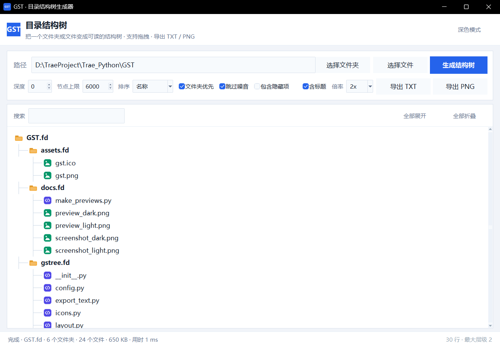
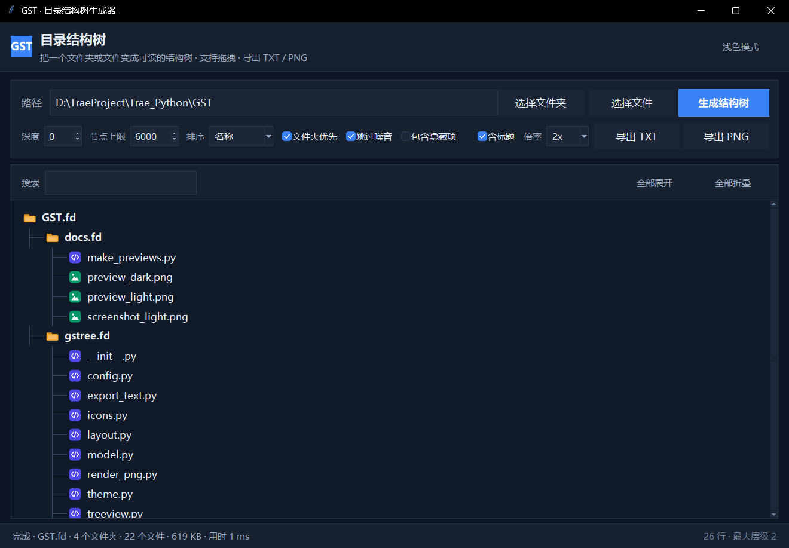
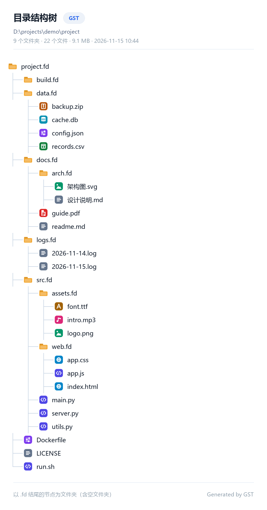
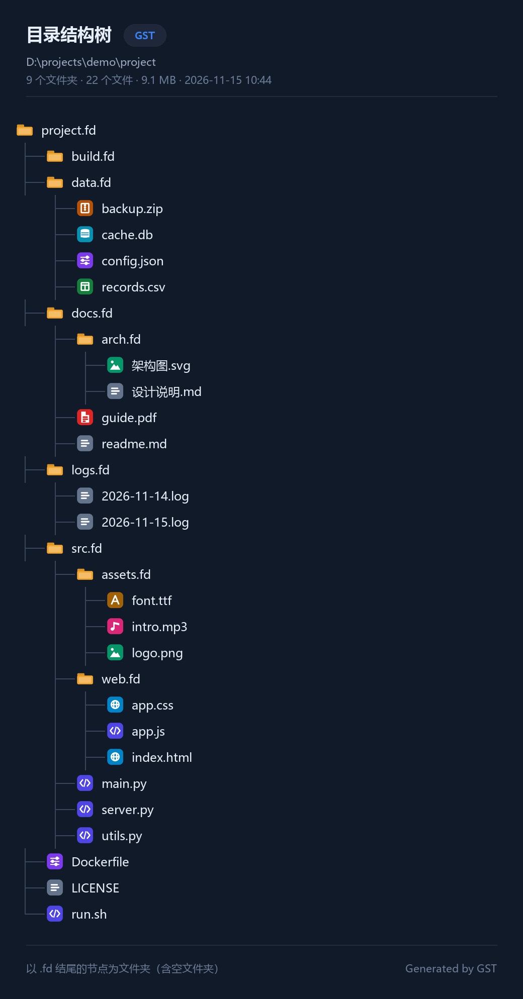

# GST · 目录结构树生成器

[](https://github.com/lfkidiejfhfud55ffll/GST/actions/workflows/ci.yml)
[](LICENSE)
[](https://www.python.org/)

把一个文件夹（或单个文件）变成一棵可读、可导出的结构树。
图形界面用 Tkinter + Pillow 实现，零外部渲染依赖：图标、勾选框、树连线全部用 Pillow 现画。



---

## 1. 它做什么

| 需求 | 实现 |
| --- | --- |
| 输入区可键入路径，也可用资源管理器选择 | 顶部「路径」输入框 + 「选择文件夹」「选择文件」两个按钮，另外支持从资源管理器**直接拖入** |
| 输出区以输入路径为根画出结构树 | 中部画布，先序遍历 + `├── └── │` 连线，文件夹可点击折叠 |
| 节点只显示文件名与文件类型 | 例如 `textfile.txt`、`pic.png`，不显示大小、修改时间等额外列（这些放在状态栏） |
| 非叶节点（含空文件夹）加 `.fd` 后缀 | `root.fd`、`build.fd`（空文件夹同样是 `.fd`）；本身已以 `.fd` 结尾的不重复叠加 |
| 每个文件名前有代表类型的图标 | 20 类自绘图标（文件夹 / 文本 / 代码 / 网页 / 配置 / 图片 / 音频 / 视频 / 压缩包 / PDF / 文档 / 表格 / 演示 / 可执行 / 字体 / 数据库 / 密钥 / 三维 / 镜像 / 未知） |
| 输入单个文件时同样画树 | 只有一行，图标按该文件类型，名字保持原样（不加 `.fd`） |
| 导出 TXT / PNG，保存位置由用户指定 | 「导出 TXT」「导出 PNG」弹出另存为对话框，默认落在上次导出目录 |





深色主题渲染结果（导出 PNG 跟随当前主题）：



---

## 2. 快速开始

```
<你的工作目录>\
├── venv312\                ← 虚拟环境（名字随意，仓库里不含）
└── GST\                    ← 仓库根目录
    ├── app.py              ← GUI 主程序（入口）
    ├── gstree\             ← 核心库
    ├── assets\             ← 应用图标（gst.ico / gst.png）
    ├── docs\               ← 说明用图 + 生成预览图的小脚本
    ├── tests\              ← 冒烟测试
    ├── tools\              ← 生成图标的脚本
    ├── run.bat             ← 双击启动（无控制台窗口）
    ├── run-console.bat     ← 双击启动（保留控制台，便于看报错）
    └── requirements.txt
```

- **双击 `run.bat`** 即可（内部调用 `..\venv312\Scripts\pythonw.exe app.py`）。
- 命令行方式：

```bat
cd /d D:\path\to\GST
..\venv312\Scripts\python.exe app.py
```

### 依赖

`tkinter` 随 CPython 自带，额外只需要两个包（已装在 `venv312` 里）：

```bat
..\venv312\Scripts\python.exe -m pip install -i https://pypi.tuna.tsinghua.edu.cn/simple -r requirements.txt
```

- `Pillow` —— 图标、勾选框、PNG 导出全部由它绘制
- `tkinterdnd2` —— 拖拽支持；**缺失也不影响启动**，程序会自动降级为普通窗口（只是不能拖文件进来）

---

## 3. 界面说明

**输入区**

- `路径`：可直接粘贴路径，回车即生成；支持带引号、带尾部空格的路径（会自动清洗），也接受 `file:///D:/xxx` 形式。
- `选择文件夹` / `选择文件`：走系统对话框。
- `生成结构树`：重新扫描当前路径（改成任意选项后也会自动重扫）。
- 选项行：
  - `深度`：`0` 表示不限层数，`1` 表示只看根的直接子项，以此类推。
  - `节点上限`：默认 6000，超过后停止展开并在状态栏提示「已截断」。
  - `排序`：名称（自然序，`file2` 在 `file10` 前）/ 大小 / 修改时间 / 类型。
  - `文件夹优先`：同级目录排在文件前面。
  - `跳过噪音`：忽略 `.git`、`node_modules`、`__pycache__`、`venv`、`.venv` 等。
  - `包含隐藏项`：默认隐藏 `.` 开头的项目与 Windows 隐藏属性项。
- 导出区：`含标题` 控制 TXT/PNG 是否带标题与统计信息；`倍率` 控制 PNG 清晰度（1x–4x，默认 2x 适合截图与文档）。

**输出区**

- 单击文件夹行折叠/展开；双击任何一行在资源管理器中定位。
- 右键菜单：复制完整路径、复制文件名、在资源管理器中显示、**以此为根重新生成**、展开/折叠此文件夹、全部展开/折叠。
- `搜索`：输入关键字即时过滤（子串、不区分大小写），自动展开命中项的父级并跳到第一个命中，`Ctrl+F` 聚焦搜索框。
- 画布虚拟化：只绘制可视区域内的行，几万节点也不卡。

**状态栏**

- 左侧：当前动作结果 / 扫描统计（`4 个文件夹 · 15 个文件 · 391 KB · 用时 1 ms`）。
- 右侧：`行数 · 最大层级`。
- 鼠标停在某一行时，状态栏显示该行的完整路径、大小、修改时间。

**快捷键**

| 快捷键 | 作用 |
| --- | --- |
| `Ctrl+R` / `F5` | 重新生成 |
| `Ctrl+T` | 导出 TXT |
| `Ctrl+P` | 导出 PNG |
| `Ctrl+F` | 聚焦搜索 |
| `Ctrl+E` / `Ctrl+W` | 全部展开 / 全部折叠 |
| `Ctrl+C`（焦点在树上） | 复制选中项路径 |
| `↑ ↓ PageUp PageDown` | 树上移动选中行 |
| `滚轮` | 纵向滚动，一格 = 4 行（约 104px）；想更快/更慢改 `gstree/treeview.py` 顶部的 `WHEEL_ROWS` |
| `Shift + 滚轮` | 横向滚动 |

---

## 4. 命名与图标规则

- **文件夹一律 `.fd`**：`src` → `src.fd`；空文件夹也带 `.fd`，因为「是不是叶子」和「是不是文件夹」是两件事。
- **文件保持原样**：`textfile.txt`、`main.py`，不做后缀改写。
- **单个文件作为输入**：根节点就是那个文件本身（例如 `readme.md`），不加 `.fd`。
- 图标按扩展名 + 特殊文件名共同判定：`Dockerfile`→配置、`MainFile`→代码、`.gitignore`→配置、无扩展名→未知（灰）。完整映射见 `gstree/icons.py` 的 `EXT_CATEGORY` / `NAME_CATEGORY`。

导出的 TXT 长这样（UTF-8 with BOM，Windows 记事本直接打开不乱码）：

```
目录结构树
根路径: D:\projects\demo\project
生成时间: 2026-11-15 10:44
统计: 3 个文件夹 · 5 个文件 · 9.1 MB

project.fd
├── build.fd
├── docs.fd
│   └── readme.md
├── src.fd
│   ├── main.py
│   └── utils.py
└── LICENSE
```

其中 `build.fd` 是空文件夹，一样带 `.fd`——"是不是叶子"和"是不是文件夹"是两件独立的事。

导出的 PNG 是「一张图」，包含标题、根路径、统计、完整树、底部图例（说明 `.fd` 的含义），背景与当前主题一致；宽度自适应最长名字（上限 1500px 后省略号截断），总边长超过 24000px 时自动降倍率。

---

## 5. 代码结构

| 文件 | 职责 |
| --- | --- |
| `app.py` | GUI：主题、布局、扫描线程、搜索、导出、拖拽、快捷键、配置持久化 |
| `gstree/model.py` | 扫描器：`Node` / `ScanOptions` / `ScanStats` / `scan_path()`；用 `os.scandir` 递归，单条 `OSError` 不影响整体，符号链接与 reparse point 不跟随 |
| `gstree/icons.py` | 20 类图标 + 复选框指示器，纯 Pillow 绘制，4 倍超采样后 LANCZOS 降采样 |
| `gstree/theme.py` | 浅色 / 深色两套 `Palette`，字体族探测（首选 Microsoft YaHei UI） |
| `gstree/layout.py` | 把树拍平成行（`flatten`），记录每个节点的连线段，供画布与 PNG 共用 |
| `gstree/treeview.py` | 画布版树控件：虚拟化绘制、折叠、搜索高亮、滚轮、键盘导航 |
| `gstree/export_text.py` | TXT 渲染与写盘 |
| `gstree/render_png.py` | PNG 渲染：标题区、树体、图例、主题配色、超长文本截断 |
| `gstree/config.py` | 配置读写（`GST/.gst_config.json`，以 `.` 开头所以默认不算进树里） |
| `tests/smoke_test.py` | 纯逻辑 + 渲染的 10 组断言（扫描、`.fd`、隐藏过滤、单文件、TXT、截断、PNG、深色、图标、布局） |
| `tests/gui_smoke.py` | 真开一个 Tk 窗口跑 8 组交互断言（控件、生成、折叠、搜索、单文件、导出、主题切换、关闭） |
| `tools/make_icon.py` | 用 Pillow 生成 `assets/gst.ico`（多尺寸），可重复执行 |
| `docs/make_previews.py` | 造一个演示目录并渲染 `docs/preview_*.png` |

跑测试：

```bat
cd /d D:\path\to\GST
..\venv312\Scripts\python.exe tests\smoke_test.py
..\venv312\Scripts\python.exe tests\gui_smoke.py
```

---

## 6. 边界与已知限制

- **符号链接 / 目录联接**：默认不跟随（避免环），扫到时会跳过，不会卡死。
- **权限受限目录**：某个子目录读不动时只在该节点上记录错误，其余照常显示。
- **超大目录**：靠 `节点上限` 兜底（默认 6000，可调到 20 万）；`C:\Windows` 这种规模约 0.2 秒就能扫到上限。
- **隐藏判定**：`.` 或 `$` 开头，或带 Windows 隐藏属性；勾选「包含隐藏项」可全部纳入。
- **深色主题的标题栏**：Windows 原生标题栏颜色由系统主题决定，程序只负责窗口内容。
- **导出 PNG 的分辨率**：倍率越高文件越大（4x 的几千行树可能几十 MB），按需选择。

---

## 7. 常见问题

**双击 `run.bat` 没反应？**
用 `run-console.bat`，会保留控制台并打印报错。最常见原因是 `venv312` 被移动或重命名——此时脚本会退回系统 `pythonw`，只要系统 Python 装了 Pillow + tkinterdnd2 同样能跑。

**为什么文件夹要加 `.fd`？**
为了在纯文本导出的树里一眼区分「这行是文件夹」还是「这行是没有扩展名的文件」。导出图底部也标了这行图例。

**导出 PNG 是空白的？**
先确认树里有内容（`生成结构树` 后有行数），再导出；空白画布会提示「还没有内容」而不是生成空图。

---

## 8. 参与贡献

见 [CONTRIBUTING.md](CONTRIBUTING.md)。关键几条：测试必须全绿、不引入新的运行时依赖、`.bat` 保持纯 ASCII、测试不要碰用户真实的配置文件。改动记录写在 [CHANGELOG.md](CHANGELOG.md)。

## 9. 许可证

[MIT](LICENSE) —— 可自由用于商业项目，保留版权声明即可。

